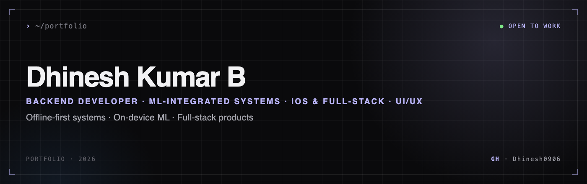

---

## S / 01 · SELECTED WORK

### 🐟 FishNet – AI-Based Fish Detection & Analysis System

> 🏆 Smart India Hackathon 2025 Finalist

An AI-powered mobile system for real-time fish identification and analysis, built for low-connectivity coastal environments.

- On-device fish species detection using TensorFlow Lite (CNN)
- Freshness, length, and weight estimation from image input
- Fully offline operation with automatic cloud sync
- Optimized for low-end devices (2–3GB RAM, <2s inference)
- Hybrid storage using SQLite (offline) and Firestore (cloud)

`INFERENCE < 2.0s` · `RAM 2–3 GB` · `UPLINK OPTIONAL`

[📽️ Demo Video](https://youtu.be/Io1LXK7Xtgo?si=2aZorN6MvpMa-jiY)  ·  [🔗 GitHub Repo](https://github.com/Dhinesh0906/fish-net)

---

### 🚀 GTM Engine – AI-Powered Go-to-Market System

A self-hosted Python system for building a company database and running personalized outbound campaigns.

- Collects and deduplicates company data from public sources into a searchable database
- Discovers contacts, researches businesses, and matches leads to product-specific customer segments
- Uses AI to draft grounded outreach and replies, with validation checks and human review
- Tracks delivery, responses, and campaign performance through an operator dashboard
- Uses SQLite, DuckDB, FastAPI, local AI models, and Amazon SES; the public repo shares a selected code sample and full architecture README

`SELF-HOSTED` · `LOCAL AI` · `SES DELIVERY`

[🔗 GitHub Repo](https://github.com/Dhinesh0906/gtm-engine)

---

### 🎬 AI Cinema Shorts – Autonomous Short-Film Creator

An Apple Silicon pipeline that turns an idea into a subtitled 30–60 second vertical film.

- Generates stories, character art, animated shots, narration, sound, and music
- Checks each stage with an independent AI critic and regenerates failed assets
- Renders the final video with captions and supports YouTube Shorts publishing
- Offers Telegram controls for starting, monitoring, pausing, and resuming jobs
- Runs its heavy models locally and uses the free Ollama Cloud tier for text models

`30–60S FILMS` · `LOCAL MODELS` · `TELEGRAM CONTROL`

[🔗 GitHub Repo](https://github.com/Dhinesh0906/ai-cinema-shorts)

---

### 🌱 Eco-gram – A Social Media App for Farmers

> 🏆 IEEE YESIST12 2024 Finalist – Maker Fair Track

An App that empowers farmers by providing:

- Real-time expert consultation via chat/video
- Offline peer-to-peer messaging without internet
- Marketplace to sell produce directly to buyers
- Real-time weather and market price insights
- Community forums for collaborative learning

`OFFLINE P2P` · `MARKETPLACE` · `WEATHER + PRICES`

[📽️ Demo Video](https://youtube.com/shorts/QQvQKb0OC24?si=cM_lkAalng9QlldC)  ·  [🔗 GitHub Repo](https://github.com/Dhinesh0906/Eco-gram)

---

### 💼 Career Hub – Job Aggregation & Recommendation System

A backend-driven job platform featuring:

- Real-time job search and filtering
- Recommendation logic based on user preferences
- Resume builder with PDF export
- Job alerts and application tracking
- Integrated chatbot for career guidance

`JOB AGGREGATION` · `PDF EXPORT` · `JOB ALERTS`

[🌐 Live Demo](https://career-hub-rdz0.onrender.com)  ·  [🔗 GitHub Repo](https://github.com/Dhinesh0906/Career-Hub)

---

### 🎮 Winvoy – Windows PC Games on iPhone

A fork of [Madeira](https://github.com/willfaust/Madeira) that runs Windows PC games on iPhone without a jailbreak.

- Uses FEX-Emu, Wine, and DXMT to run x86 games and render Direct3D graphics through Metal
- Adds fixes for game compatibility, memory use, and performance on iOS
- Supports a game library, Steam integration, controllers, and touch controls
- Tested with God of War (2018) on iPhone 15 Pro and X-Men Origins: Wolverine (2009) on iPad Air 4

`x86 ON iOS` · `STEAM INTEGRATION` · `TOUCH CONTROLS`

[🔗 GitHub Repo](https://github.com/Dhinesh0906/Winvoy)

---

## S / 02 · STACK

```
▸ LANGUAGE    Python
▸ FRAMEWORK   FastAPI
▸ DATA        SQLite · DuckDB · Firestore
▸ CLOUD       Amazon SES
▸ ML / EDGE   TensorFlow Lite · CNN · Ollama
▸ PLATFORM    iOS · Metal · Apple Silicon · Telegram Bot API
▸ COMPAT      FEX-Emu · Wine · DXMT
```

---

## S / 03 · CONTACT

<div align="center">

[](https://dhinesh-portfolio-red.vercel.app)
[](https://www.linkedin.com/in/dhinesh-kumar-b-876a90320/)
[](mailto:dhineshkumar0906@gmail.com)

</div>
