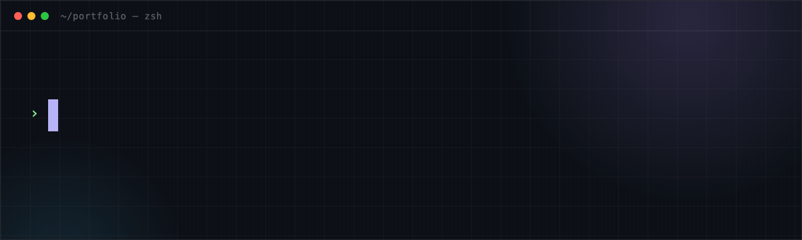
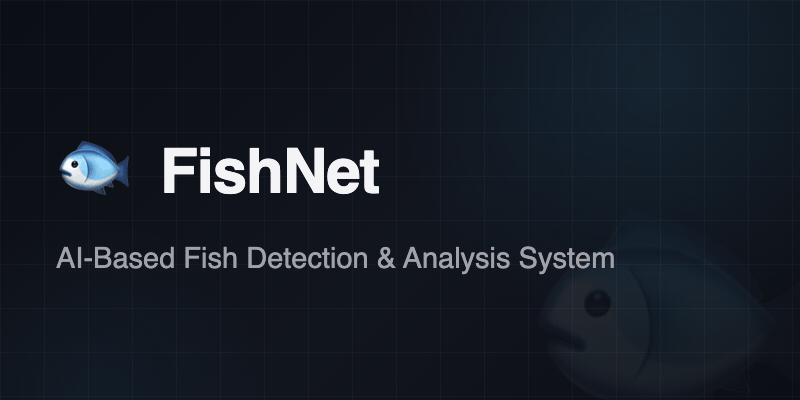
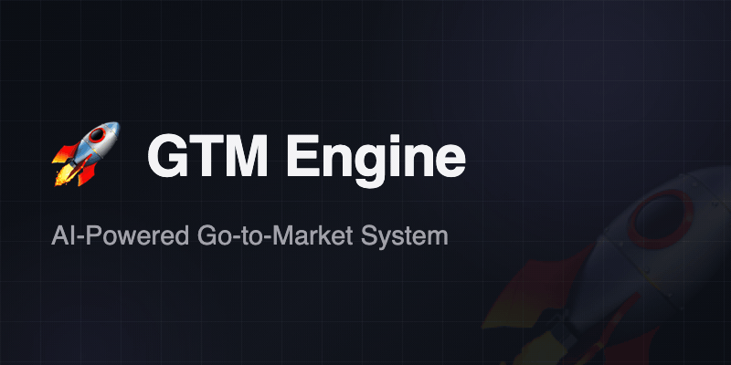
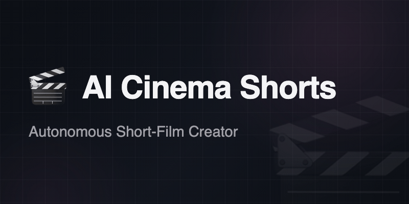
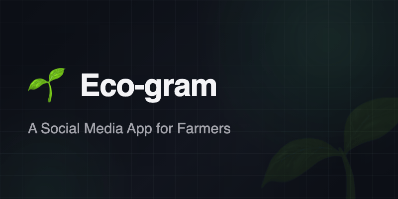
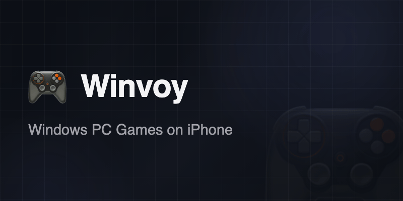

## 🚀 Selected Work

<table>
<tr>
<td width="50%">

🏆 **Smart India Hackathon 2025 Finalist**

An AI-powered mobile system for real-time fish identification and analysis, built for low-connectivity coastal environments.

- On-device fish species detection using TensorFlow Lite (CNN)
- Freshness, length, and weight estimation from image input
- Fully offline operation with automatic cloud sync
- Optimized for low-end devices (2–3GB RAM, <2s inference)
- Hybrid storage using SQLite (offline) and Firestore (cloud)

  

[📽️ Demo Video](https://youtu.be/Io1LXK7Xtgo?si=2aZorN6MvpMa-jiY) · [🔗 GitHub Repo](https://github.com/Dhinesh0906/fish-net)

</td>
<td width="50%">

A self-hosted Python system for building a company database and running personalized outbound campaigns.

- Collects and deduplicates company data from public sources into a searchable database
- Discovers contacts, researches businesses, and matches leads to product-specific customer segments
- Uses AI to draft grounded outreach and replies, with validation checks and human review
- Tracks delivery, responses, and campaign performance through an operator dashboard
- Uses SQLite, DuckDB, FastAPI, local AI models, and Amazon SES; the public repo shares a selected code sample and full architecture README

  

[🔗 GitHub Repo](https://github.com/Dhinesh0906/gtm-engine)

</td>
</tr>
<tr>
<td width="50%">

An Apple Silicon pipeline that turns an idea into a subtitled 30–60 second vertical film.

- Generates stories, character art, animated shots, narration, sound, and music
- Checks each stage with an independent AI critic and regenerates failed assets
- Renders the final video with captions and supports YouTube Shorts publishing
- Offers Telegram controls for starting, monitoring, pausing, and resuming jobs
- Runs its heavy models locally and uses the free Ollama Cloud tier for text models

 

[🔗 GitHub Repo](https://github.com/Dhinesh0906/ai-cinema-shorts)

</td>
<td width="50%">

🏆 **IEEE YESIST12 2024 Finalist – Maker Fair Track**

An App that empowers farmers by providing:

- Real-time expert consultation via chat/video
- Offline peer-to-peer messaging without internet
- Marketplace to sell produce directly to buyers
- Real-time weather and market price insights
- Community forums for collaborative learning

 

[📽️ Demo Video](https://youtube.com/shorts/QQvQKb0OC24?si=cM_lkAalng9QlldC) · [🔗 GitHub Repo](https://github.com/Dhinesh0906/Eco-gram)

</td>
</tr>
<tr>
<td width="50%">

A backend-driven job platform featuring:

- Real-time job search and filtering
- Recommendation logic based on user preferences
- Resume builder with PDF export
- Job alerts and application tracking
- Integrated chatbot for career guidance

 

[🌐 Live Demo](https://career-hub-rdz0.onrender.com) · [🔗 GitHub Repo](https://github.com/Dhinesh0906/Career-Hub)

</td>
<td width="50%">

A fork of [Madeira](https://github.com/willfaust/Madeira) that runs Windows PC games on iPhone without a jailbreak.

- Uses FEX-Emu, Wine, and DXMT to run x86 games and render Direct3D graphics through Metal
- Adds fixes for game compatibility, memory use, and performance on iOS
- Supports a game library, Steam integration, controllers, and touch controls
- Tested with God of War (2018) on iPhone 15 Pro and X-Men Origins: Wolverine (2009) on iPad Air 4

 

[🔗 GitHub Repo](https://github.com/Dhinesh0906/Winvoy)

</td>
</tr>
</table>

## 🛠️ Stack

## 📬 Contact

